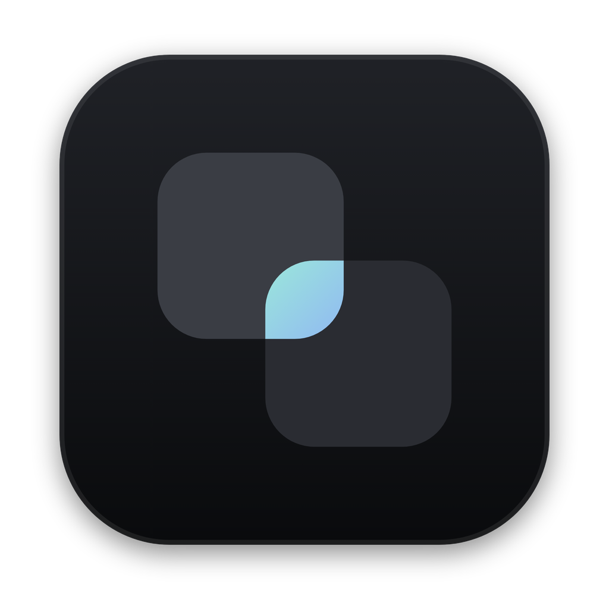
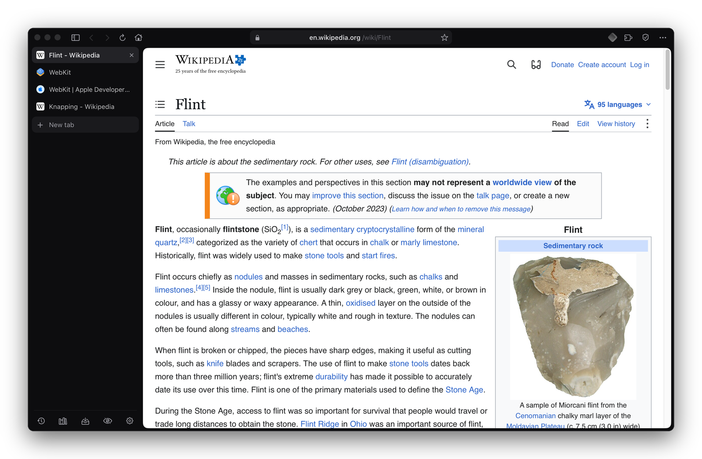
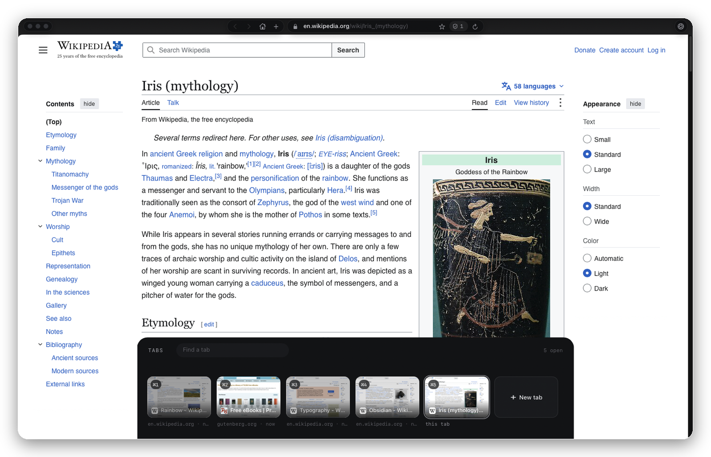
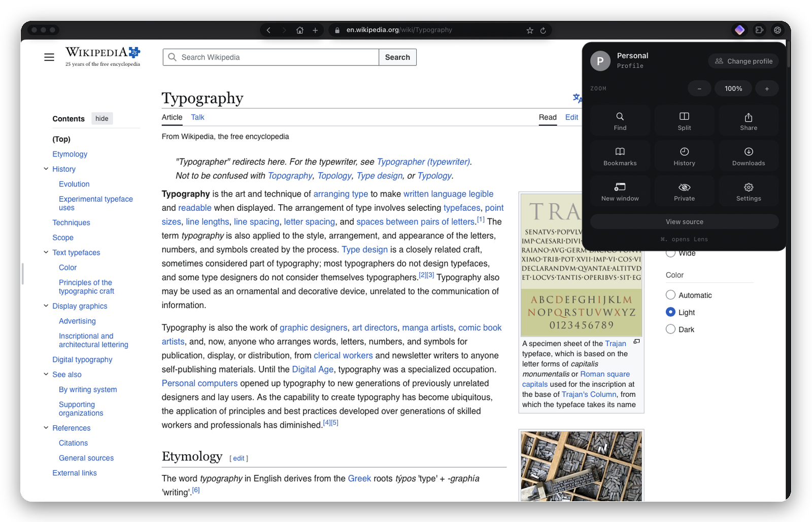
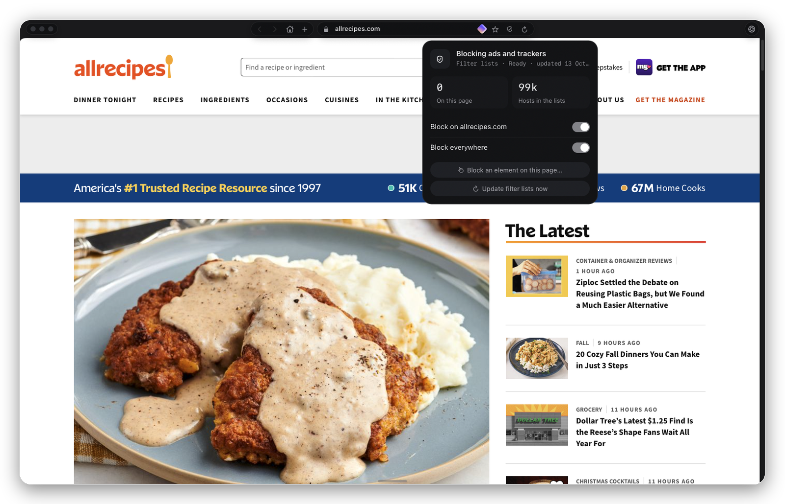
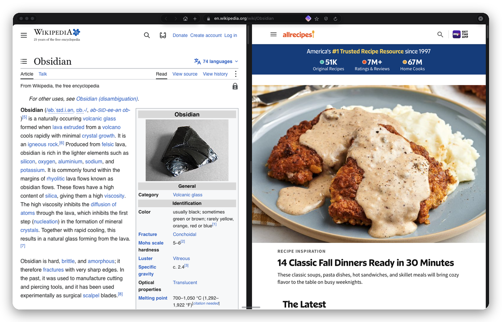
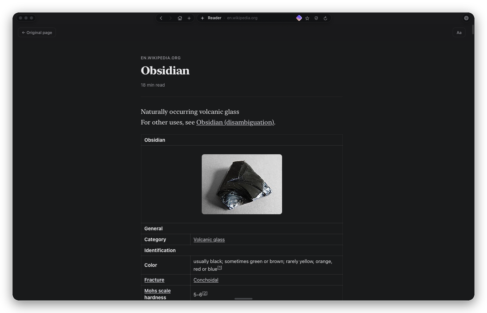
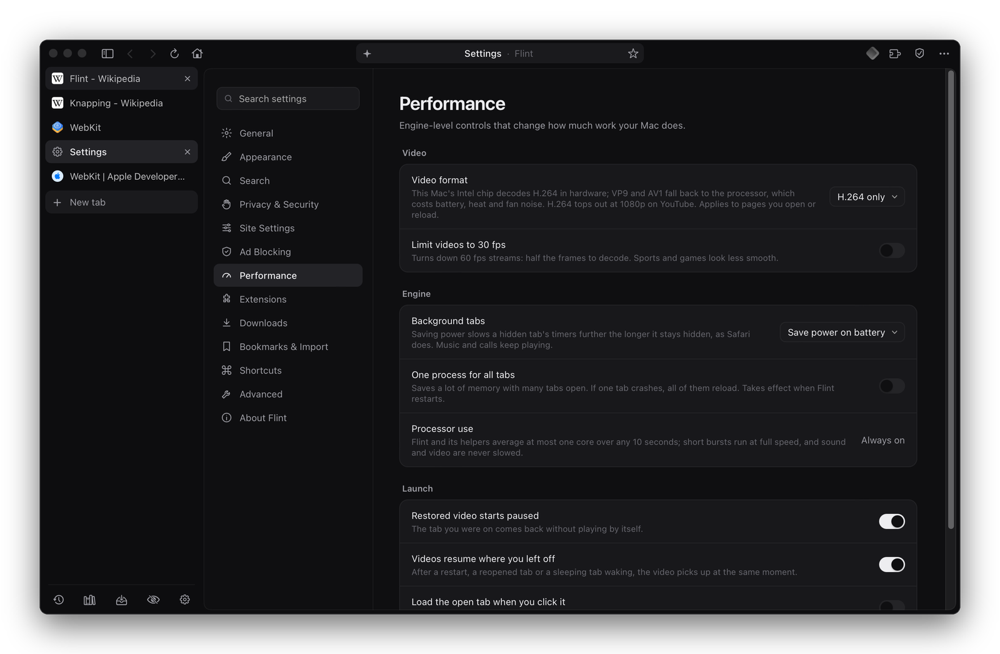

<p align="center">
  
</p>

<h1 align="center">Iris</h1>

<p align="center">
  A calm, minimal web browser for macOS.<br>
  Native AppKit interface, Safari's engine underneath, no Chromium.
</p>

<p align="center">
  
  
  
  
</p>

<p align="center">
  
</p>

## The design

Iris gives the page the whole window. There is no tab bar and no sidebar: back, forward and the address float as small capsules in a thin band above the page, and everything else stays out of sight until you reach for it.

- **Tabs come up from the bottom edge.** Move the pointer to the bottom of the window (or press ⌘S) and your tabs rise as a timeline of page previews, the one you're on at the right end. Pinned tabs sit first, the same size as the rest; a New tab card closes the row.
- **Bookmarks live under the address.** Click the address and it's selected, ready to type over, with your bookmarks underneath: folders open in place, no dropdown menus, and your other open tabs below them.
- **Each button does one job.** The lock is this site (connection, cookies, JavaScript, location, camera and microphone, clear data). The shield is blocking (what was blocked here, on or off for this site, block an element). **Lens** (⌘.) is the browser itself: profile, extensions, zoom, and the rest of the menu.

## Features

**Browsing**
- Split view (two tabs side by side), private windows, reader mode, tab sleep after a set idle time
- Location, camera and microphone for sites that ask, decided once per site
- Profiles, each with its own sign-ins, cookies, history and tabs, marked by a colour (separate website data needs macOS 14)
- Address suggestions from history, bookmarks and open tabs; built-in pages at `iris://settings`, `iris://downloads`, `iris://history`, `iris://bookmarks`
- Bookmark import from Helium

**Privacy**
- Built-in content blocker with filter lists, cosmetic filtering and an element picker
- Cookie banners declined automatically (never accepted)
- Tracking parameters stripped from links, Global Privacy Control, optional HTTPS-only

**Video**
- Picture in picture from the address bar, and automatically when you switch away from a playing tab
- Videos resume where you left off after a restart, a reopened tab or a sleeping tab waking
- The tab restored at launch comes back paused
- Codec forcing (e.g. H.264 instead of VP9/AV1) for cooler playback on Intel Macs

**Downloads**
- Segmented downloads over up to 8 connections, and a finished connection takes over half of the largest segment still downloading
- Pause, resume, retry, queue limit and speed limit; finished files are quarantined like Safari's

**Extensions**
- Installs Chrome Web Store extensions through its own extension layer, built against the Chrome APIs rather than any one extension: runtime messaging, storage, tabs, scripting (with frame targeting and registered content scripts), context menus, user scripts and declarativeNetRequest (translated to WebKit content rules). Proton Pass, SponsorBlock and Enhancer for YouTube run on it.

**Performance**
- One rule: background pages share a quarter of the Mac's processor on battery and 40% plugged in, averaged over 10 seconds. Short bursts run at full speed; the page on screen, anything that played sound in the last 90 seconds and Picture in Picture are never slowed.
- Background tab throttling that adapts to battery or power

## Screenshots

<table>
  <tr>
    <td width="50%"><p align="center"><sub>Tabs, from the bottom edge</sub></p></td>
    <td width="50%"><p align="center"><sub>Lens: the browser in one panel</sub></p></td>
  </tr>
  <tr>
    <td width="50%"><p align="center"><sub>The shield: blocking, for this site or everywhere</sub></p></td>
    <td width="50%"><p align="center"><sub>Split view</sub></p></td>
  </tr>
  <tr>
    <td width="50%"><p align="center"><sub>Reader mode</sub></p></td>
    <td width="50%"><p align="center"><sub>Settings</sub></p></td>
  </tr>
</table>

## Requirements

- macOS 12.3 or later (Intel or Apple silicon); separate profile data needs macOS 14
- Xcode Command Line Tools (`xcode-select --install`)

## Build

```sh
./iris          # build if anything changed, then open
./iris build    # force a rebuild
./iris stop     # quit Iris
```

The script compiles `Iris.m` with clang and bundles `ext-shim.js`, `pages/` and `Iris.icns` into `Iris.app`. It signs with a local identity named "Iris Local Signing" if one exists in your keychain (so macOS permissions persist between builds), otherwise ad hoc.

## Development

While Iris is open it watches its own source. A change is built in the background into `.staged/`, and an **Update** pill appears beside the address; click it when you're ready and Iris restarts into the new build with your tabs restored. Nothing restarts on its own.

## Layout

| Path | What it is |
|---|---|
| `Iris.m` | The whole app: window, capsules, tab strip, panels, blocker, downloads, extensions, settings |
| `ext-shim.js` | The Chrome extension API layer, injected into extension pages |
| `pages/` | Built-in pages served at `iris://` |
| `iris` | Build, sign and update script |
| `Iris.icns` | App icon |
| `assets/` | Images for this page |
