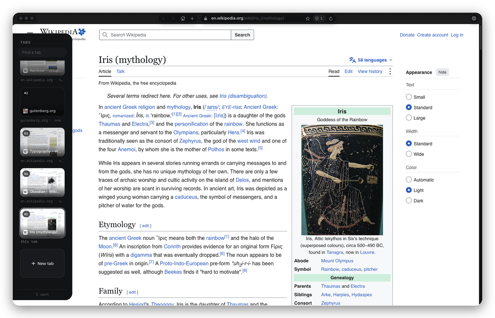
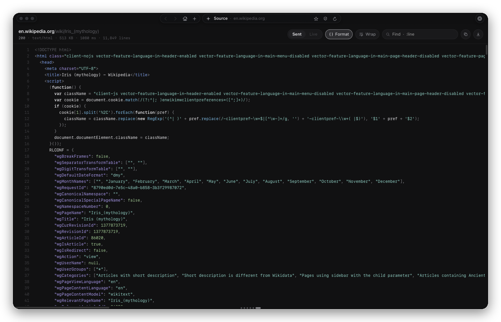
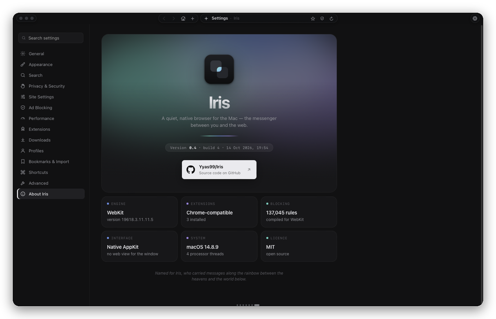
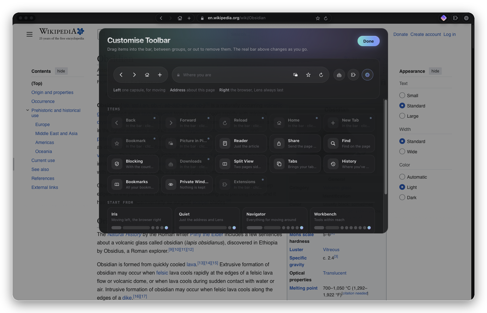

<p align="center">
  
</p>

<h1 align="center">Iris</h1>

<p align="center">
  A quiet, native browser for the Mac: the messenger between you and the web.<br>
  AppKit interface, Safari's engine underneath, Chrome extensions on its own layer.
</p>

<p align="center">
  
  
  
  
</p>

<p align="center">
  
</p>

## The design

Iris gives the page the whole window. There is no tab bar and no sidebar. The controls float in a thin band above the page in three small groups: moving on the left (back, forward, reload), where you are in the middle (the address), and the browser on the right (blocking, downloads, extensions, Lens). Everything else waits at the edges until you reach for it.

- **Tabs come out of an edge.** A quiet map of your tabs (one dot each, the one you're on a longer bar) sits on the bottom edge, or down the left or right side if you prefer. As the pointer comes near, the map leans out to meet it; slow down at the edge and your tabs slide out as cards with live previews. Passing by on the way to the Dock doesn't count: Iris waits for the pointer to settle.
- **Aperture.** Pages load with a line that opens from the centre of the window outward, like an iris widening, in teal, blue and violet that flow out from the middle. A soft core breathes while the page works; when it arrives, the line reaches both edges, blooms once and fades.
- **Bookmarks live under the address.** Click the address and it's selected, ready to type over, with your bookmarks and open tabs underneath; right-click any of them for more.
- **Each button does one job.** The lock is this site (connection, cookies, JavaScript, location, camera, microphone). The shield is blocking (what was blocked here, on or off for this site, block an element). The puzzle is your extensions. **Lens** (⌘.) is the browser itself: your profile, zoom, tools and the rest of the menu.
- **The bar is yours.** Right-click it and choose Customise Toolbar: drag any of 18 items between the left, the address bar and the right, and the real bar changes as you drag.
- **Iris's own colours.** Teal, blue and violet mark the moments that are Iris's: a page loading, the tab you're on, a download's progress, a new build waiting. Everything else stays in your accent colour, and panels open from their button like an aperture.

<p align="center">
  
</p>

## Features

**Tabs**
- Tabs along the bottom, or down the left or right side (Settings → General → Tabs)
- Cards with page previews, ⌘1–9 badges, pin and close; drag to reorder, arrows and Return to move between them, type to find one
- Recency shows as brightness, not position: every tab stays where your hand remembers it
- Background tabs sleep after a set idle time and wake instantly

**Toolbar**
- Customise Toolbar: drag items between three groups, out to remove them, or click one to add it; presets (Iris, Quiet, Navigator, Workbench) and the address bar's width
- Right-click any button to move it to another group or take it off the bar
- Items include back, forward, reload, home, new tab, bookmark, picture in picture, reader, share, find, blocking, downloads, split view, tabs, history, bookmarks, private window and extensions

**Browsing**
- Split view, private windows, reader mode, profiles (each with its own sign-ins, history and tabs)
- Home is part of a tab's history: Back from it returns to the page you left, as you left it
- Bookmarks under the address: drag them to rearrange, or drop one on a folder to file it
- A built-in code viewer for View Source: the source as sent, or the live page after its scripts ran, laid out and highlighted, with find across the whole file
- Iris's own right-click menus, with icons and quick actions
- Built-in pages at `iris://settings`, `iris://history`, `iris://bookmarks`, `iris://downloads`; bookmark import from Helium

**Privacy**
- Built-in content blocker with EasyList, EasyPrivacy and other lists, element hiding and an element picker
- The lists compile in a separate helper process, so the browser never carries the memory peak
- Cookie banners declined automatically (never accepted)
- Tracking parameters stripped from links, Global Privacy Control, optional HTTPS-only

**Video**
- Picture in picture from the address bar, and optionally whenever you switch away from a playing tab
- A small player for whatever's playing in another tab, shown only while something is actually playing or paused part-way
- Videos resume where you left off; codec forcing (H.264 instead of VP9/AV1) for cooler playback on Intel Macs

**Downloads**
- Segmented downloads over up to 8 connections, pause, resume, retry, queue and speed limits; finished files are quarantined like Safari's

**Extensions**
- A puzzle button opens them in a panel: open one, pin it beside the button, or reach its options
- Installs Chrome Web Store extensions through its own extension layer, built against the Chrome APIs rather than any one extension: runtime messaging, storage, tabs, scripting, context menus, user scripts and declarativeNetRequest (translated to WebKit content rules). Proton Pass, SponsorBlock and Enhancer for YouTube run on it.

**Performance and reliability**
- Background pages share a quarter of the Mac's processor on battery and 40% plugged in, averaged over 10 seconds; the page on screen, anything that played sound recently and Picture in Picture are never slowed (Settings → Performance, or switch it off)
- Its own crash reporter: crashes and page-engine failures are written to `crashes/` beside the app, never to Apple

## Screenshots

<table>
  <tr>
    <td width="50%"><p align="center"><sub>Tabs, out of the bottom edge</sub></p></td>
    <td width="50%"><p align="center"><sub>Or down a side</sub></p></td>
  </tr>
  <tr>
    <td width="50%"><p align="center"><sub>Lens: your profile and the browser in one panel</sub></p></td>
    <td width="50%"><p align="center"><sub>The shield: blocking, for this site or everywhere</sub></p></td>
  </tr>
  <tr>
    <td width="50%"><p align="center"><sub>Split view</sub></p></td>
    <td width="50%"><p align="center"><sub>Reader mode</sub></p></td>
  </tr>
  <tr>
    <td width="50%"><p align="center"><sub>View Source, in Iris's own code viewer</sub></p></td>
    <td width="50%"><p align="center"><sub>About Iris</sub></p></td>
  </tr>
  <tr>
    <td width="50%"><p align="center"><sub>Customise Toolbar: the real bar is the preview</sub></p></td>
    <td width="50%"><p align="center"><sub>Settings</sub></p></td>
  </tr>
</table>

## Requirements

- macOS 12.3 or later (Intel or Apple silicon); separate profile data needs macOS 14
- Xcode Command Line Tools (`xcode-select --install`)

## Build

```sh
./iris          # build if anything changed, then open
./iris build    # force a rebuild
./iris stop     # quit Iris
```

The script compiles `Iris.m` with clang and bundles `ext-shim.js`, `pages/` and `Iris.icns` into `Iris.app`. It signs with a local identity if one exists in your keychain (so macOS permissions persist between builds), otherwise ad hoc.

## Development

While Iris is open it watches its own source. A change is built in the background, and an **Update** pill appears beside the address; click it when you're ready and Iris restarts into the new build with your tabs restored. Nothing restarts on its own.

Crash reports and the event log land in `crashes/` beside the app (ignored by git).

## Layout

| Path | What it is |
|---|---|
| `Iris.m` | The whole app: window, capsules, tabs, panels, blocker, downloads, extensions, settings |
| `ext-shim.js` | The Chrome extension API layer, injected into extension pages |
| `pages/` | Built-in pages served at `iris://`, including the code viewer and Customise Toolbar |
| `iris` | Build, sign and update script |
| `Iris.icns` | App icon |
| `assets/` | Images for this page |
