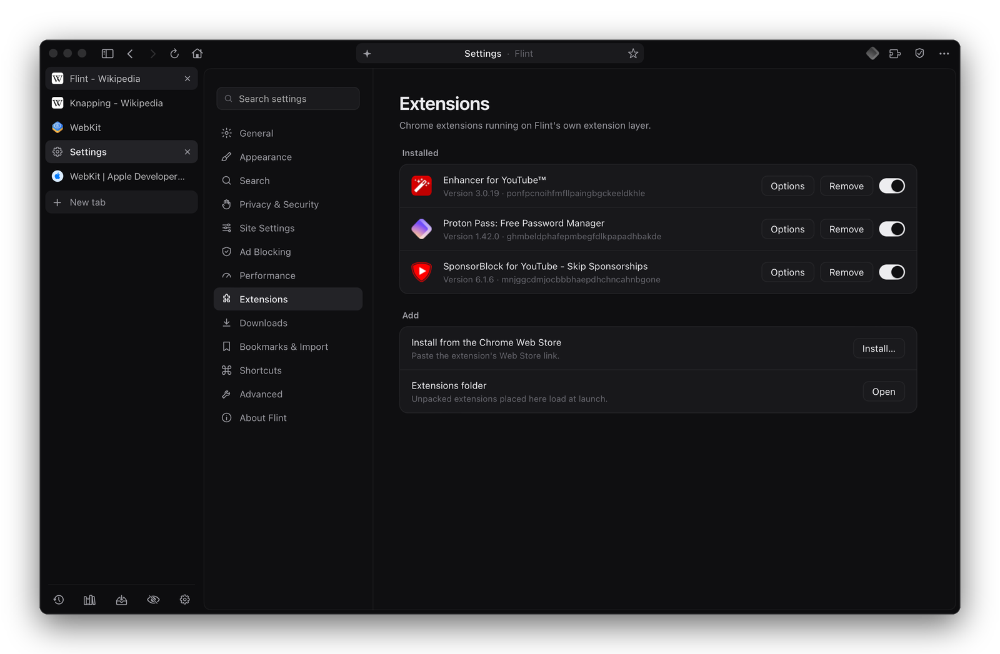

<p align="center">
  
</p>

<h1 align="center">Flint</h1>

<p align="center">
  A calm, minimal web browser for macOS.<br>
  Native AppKit interface, Safari's engine underneath, no Chromium.
</p>

<p align="center">
  
  
  
  
</p>

<p align="center">
  
</p>

## Features

**Browsing**
- Vertical tabs in a resizable side panel, bookmarks bar, split view (two tabs side by side)
- Private windows, reader mode, tab sleep after a set idle time
- Address bar with suggestions from history and bookmarks; built-in pages at `flint://settings`, `flint://downloads`, `flint://history`, `flint://bookmarks`
- Bookmark import from Helium

**Privacy**
- Built-in content blocker with filter lists, cosmetic filtering and an element picker
- Cookie banners declined automatically (never accepted)
- Tracking parameters stripped from links, Global Privacy Control, optional HTTPS-only

**Video**
- Picture in picture from the address bar, and automatically when you switch away from a playing tab
- Videos resume where you left off after a restart, a reopened tab or a sleeping tab waking
- The tab restored at launch comes back paused
- Codec forcing (e.g. H.264 instead of VP9/AV1) for cooler playback on Intel Macs

**Downloads**
- Segmented downloads over up to 8 connections, and a finished connection takes over half of the largest segment still downloading
- Pause, resume, retry, queue limit and speed limit; finished files are quarantined like Safari's

**Extensions**
- Installs Chrome Web Store extensions through its own extension layer (a subset of the Chrome extension APIs). SponsorBlock, Enhancer for YouTube and Proton Pass run on it.

**Performance**
- One rule: Flint and every process it starts average at most one CPU core over any 10 seconds. Short bursts run at full speed; audio, video and the tab you're using are never slowed.
- Background tab throttling that adapts to battery or power

## Screenshots

<table>
  <tr>
    <td width="50%"><p align="center"><sub>Split view</sub></p></td>
    <td width="50%"><p align="center"><sub>Reader mode</sub></p></td>
  </tr>
  <tr>
    <td width="50%"><p align="center"><sub>Engine-level performance settings</sub></p></td>
    <td width="50%"><p align="center"><sub>Chrome extensions</sub></p></td>
  </tr>
</table>

## Requirements

- macOS 12.3 or later (Intel or Apple silicon)
- Xcode Command Line Tools (`xcode-select --install`)

## Build

```sh
./flint          # build if anything changed, then open
./flint build    # force a rebuild
./flint stop     # quit Flint
```

The script compiles `Flint.m` with clang and bundles `ext-shim.js`, `pages/` and `Flint.icns` into `Flint.app`. It signs with a local identity named "Flint Local Signing" if one exists in your keychain (so macOS permissions persist between builds), otherwise ad hoc.

## Development

While Flint is open it watches its own source. A change is built in the background into `.staged/`, and an **Update** pill appears at the right of the toolbar; click it when you're ready and Flint restarts into the new build with your tabs restored. Nothing restarts on its own.

## Layout

| Path | What it is |
|---|---|
| `Flint.m` | The whole app: window, tabs, sidebar, blocker, downloads, extensions, settings |
| `ext-shim.js` | The Chrome extension API layer, injected into extension pages |
| `pages/` | Built-in pages served at `flint://` |
| `flint` | Build, sign and update script |
| `Flint.icns` | App icon |
| `assets/` | Images for this page |
